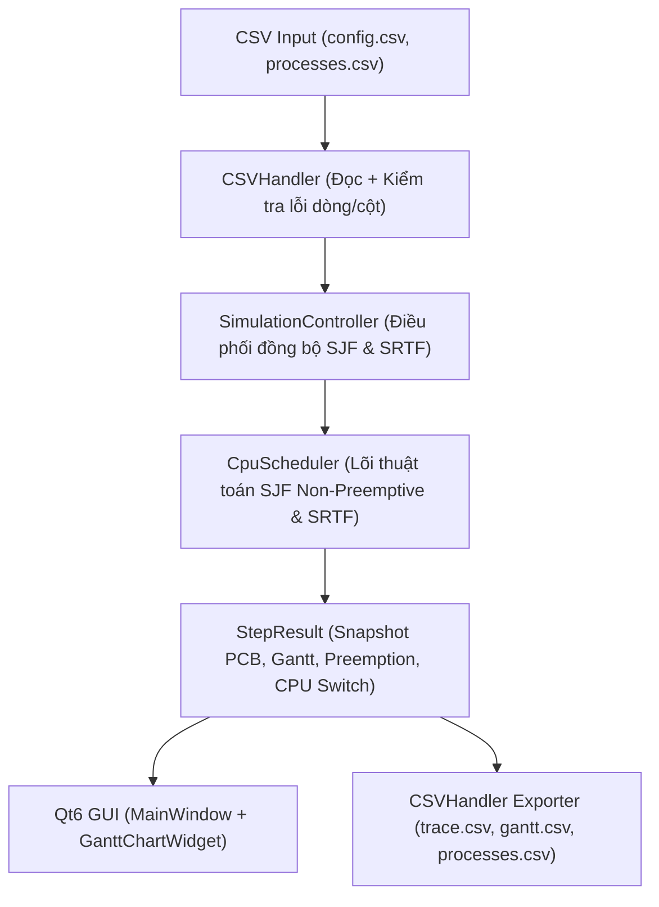
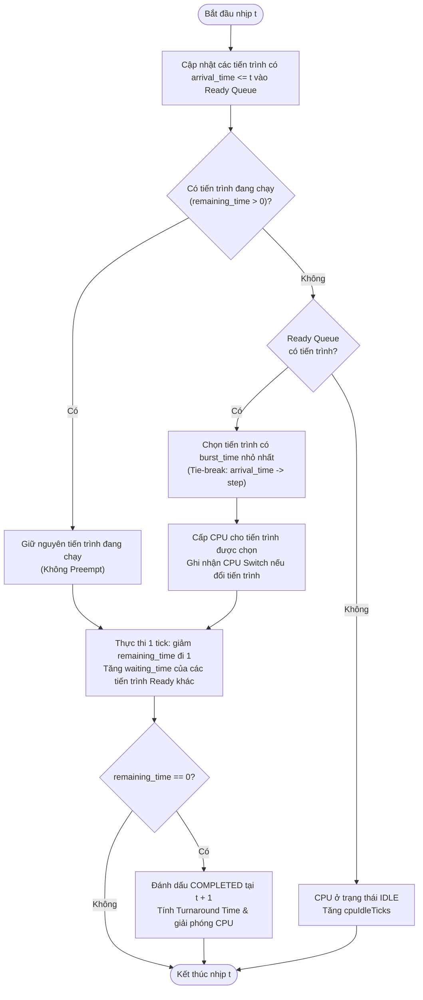
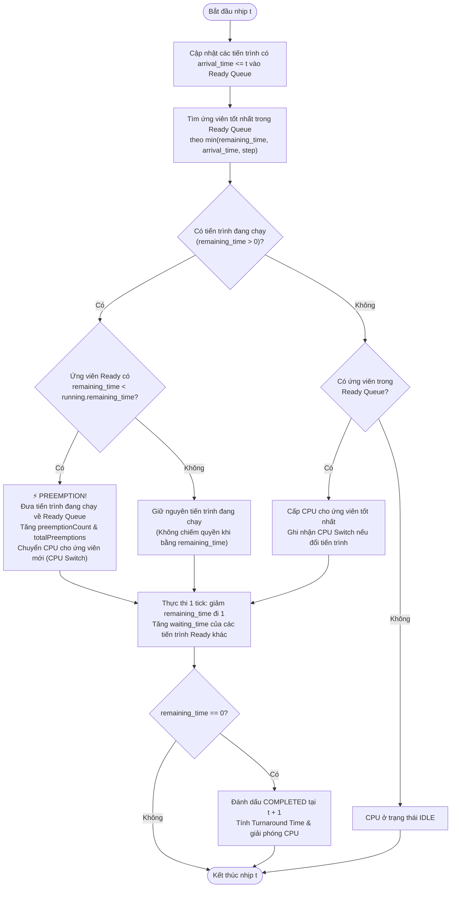

# Đặc tả mô phỏng điều phối CPU: SJF Non-Preemptive và SRTF

## 1. Phạm vi mô phỏng

Chương trình mô phỏng **điều phối CPU đơn nhân (single-core CPU scheduling)** theo nhịp thời gian rời rạc $[t, t+1)$ bằng hai giải thuật:

- **SJF Non-Preemptive** (*Shortest Job First không chiếm quyền*)
- **SRTF** (*Shortest Remaining Time First – SJF có chiếm quyền / Preemptive SJF*)

Chương trình nhận danh sách các tiến trình đầu vào với thời điểm đến (`arrival_time`) và thời gian thực thi CPU (`burst_time`). Sau mỗi nhịp đồng hồ $[t, t+1)$, chương trình cập nhật trạng thái các tiến trình (PCB), ghi nhận sự kiện **chiếm quyền (preemption)** và **chuyển ngữ cảnh CPU (CPU switch)** để giao diện hiển thị biểu đồ Gantt, bảng trạng thái tiến trình và xuất kết quả ra CSV.

Đây là chương trình **mô phỏng giải thuật hệ điều hành**, không can thiệp vào bộ lập lịch nhân (kernel scheduler) thật của Windows. Phạm vi hiện tại mô phỏng một chu kỳ CPU burst chính của mỗi tiến trình, không gồm lập lịch đa nhân (multiprocessor), hàng đợi I/O thiết bị ngoại vi hoặc cơ chế tăng độ ưu tiên theo tuổi (aging).

## 2. Đơn vị thời gian và trạng thái ban đầu

- Thời gian mô phỏng tính theo đơn vị **tick** nguyên không âm ($t = 0, 1, 2, \dots$). Mỗi tick tương ứng với `time_unit_ms` mili-giây trong cấu hình (mặc định `1 ms`).
- Mỗi bước mô phỏng thứ $k$ (`step = k`) thực thi đúng một khoảng nửa mở $[t, t+1)$ với $t = k - 1$.
- Khi bắt đầu hoặc `Reset` ($t = 0$):
  - Các tiến trình có `arrival_time == 0` ở trạng thái `READY`, các tiến trình có `arrival_time > 0` ở trạng thái `NOT_ARRIVED`.
  - Mọi tiến trình có `remaining_time = burst_time`, `waiting_time = 0`, `turnaround_time = 0`, `response_time = -1`, `preemption_count = 0`.
  - Biểu đồ Gantt rỗng, `total_preemptions = 0`, `total_cpu_switches = 0`.

## 3. Quy tắc chọn tiến trình và Tie-Breaking

| Chiến lược | Quy tắc chọn tiến trình tại mốc thời gian $t$ |
|---|---|
| **SJF Non-Preemptive** | Nếu CPU đang chạy một tiến trình chưa hoàn thành (`remaining_time > 0`), tiến trình đó tiếp tục giữ CPU cho đến khi hoàn tất. Khi CPU rỗi hoặc tiến trình trước vừa hoàn tất, chọn tiến trình trong `Ready Queue` có `burst_time` (tức `remaining_time`) nhỏ nhất. |
| **SRTF (Preemptive SJF)** | Tại mỗi mốc $t$, xét toàn bộ tiến trình trong `Ready Queue` (bao gồm cả tiến trình mới đến tại mốc $t$). Nếu có tiến trình trong `Ready Queue` có `remaining_time` **nhỏ hơn hẳn** (`<`) `remaining_time` của tiến trình đang chạy trên CPU, tiến trình đang chạy bị **chiếm quyền (Preempt)** và đưa trở lại `Ready Queue`; CPU được chuyển cho tiến trình có `remaining_time` nhỏ nhất. |

### Quy tắc phá vỡ đồng hạng (Deterministic Tie-Breaking)

Để đảm bảo cùng một bộ dữ liệu đầu vào luôn cho ra kết quả duy nhất (tái lập 100%):

1. **Giữa các tiến trình trong `Ready Queue` có cùng `remaining_time`**:
   - Ưu tiên tiến trình có **thời điểm đến (`arrival_time`) nhỏ hơn** (quy tắc FCFS).
   - Nếu cả `arrival_time` cũng bằng nhau, ưu tiên tiến trình có **thứ tự xuất hiện (`step`) nhỏ hơn** trong file CSV.
2. **Giữa tiến trình đang chạy (`Running`) và tiến trình trong `Ready Queue` (đối với SRTF)**:
   - Chỉ xảy ra **Preemption** khi ứng viên tốt nhất trong `Ready Queue` có `remaining_time` **nhỏ hơn nghiêm ngặt** (`candidate.remaining_time < running.remaining_time`).
   - Nếu bằng nhau (`candidate.remaining_time == running.remaining_time`), tiến trình đang chạy **giữ nguyên CPU** để tránh phát sinh chuyển ngữ cảnh vô ích.

## 4. Cơ chế Preemption và Chuyển CPU (CPU Switches)

### 4.1. Sự kiện Chiếm quyền (Preemption)

Tại đầu nhịp $[t, t+1)$, sự kiện **Preemption** được ghi nhận khi và chỉ khi:

1. Ở nhịp trước $[t-1, t)$, tiến trình $P_{\text{prev}}$ đang giữ CPU.
2. Tại mốc $t$, $P_{\text{prev}}$ vẫn chưa hoàn thành (`remaining_time > 0`).
3. Thuật toán SRTF chọn một tiến trình mới $P_{\text{curr}} \ne P_{\text{prev}}$ vì $P_{\text{curr}}.\text{remaining\_time} < P_{\text{prev}}.\text{remaining\_time}$.

Khi đó:
- Trạng thái của $P_{\text{prev}}$ chuyển từ `RUNNING` về `READY`.
- Bộ đếm `preemption_count` của $P_{\text{prev}}$ tăng thêm $1$, và tổng `total_preemptions` của toàn hệ thống tăng thêm $1$.
- Đoạn Gantt của $P_{\text{prev}}$ kết thúc tại mốc $t$ với cờ `ended_by_preemption = true` và `preempted_by_pid = P_curr`.

### 4.2. Sự kiện Chuyển CPU (CPU Context Switch)

Một lần **chuyển CPU (`cpu_switched = true`)** được ghi nhận tại mốc $t > 0$ khi CPU bắt đầu thực thi một tiến trình hoạt động $P_{\text{curr}}$ (`running_pid != "IDLE"`) khác với trạng thái/tiến trình của nhịp liền trước (`running_pid != previous_pid`).

- Mỗi lần **Preemption** luôn kéo theo ít nhất **2 lần chuyển CPU** trong toàn bộ vòng đời (một lần chuyển từ tiến trình bị chiếm quyền sang tiến trình ngắn hơn, và một lần chuyển ngược lại khi tiến trình bị chiếm quyền được cấp CPU trở lại).
- Với **SJF Non-Preemptive**, số lần `total_preemptions` luôn bằng `0`, và số lần `total_cpu_switches` bằng đúng $N - 1$ (với $N$ là số tiến trình thực thi sau tiến trình đầu tiên).

## 5. Cấu trúc dữ liệu cốt lõi (`source/models.h`)

```cpp
struct ProcessStatus {
    int stepOrder;
    std::string processId;
    int arrivalTime;
    int burstTime;
    int remainingTime;
    int waitingTime;
    int turnaroundTime;
    int responseTime; // -1 nếu chưa từng được cấp CPU
    std::optional<int> startTime;
    std::optional<int> completionTime;
    int preemptionCount;
    ProcessState state; // NotArrived, Ready, Running, Completed
};

struct GanttSegment {
    int segmentIndex;
    int startTime;
    int endTime;
    int duration;
    std::string processId; // "IDLE" nếu CPU rỗi
    bool isIdle;
    bool endedByPreemption;
    std::string preemptedByPid;
};
```

### Công thức tính các chỉ số đánh giá

Với mỗi tiến trình $P_i$:
- **Thời gian hoàn thành (Completion Time – $CT_i$)**: thời điểm $t$ mà `remaining_time` giảm về $0$.
- **Thời gian lưu hệ thống (Turnaround Time – $TAT_i$)**:
  $$TAT_i = CT_i - \text{ArrivalTime}_i$$
- **Thời gian chờ (Waiting Time – $WT_i$)**: tổng số nhịp tiến trình nằm trong `Ready Queue`:
  $$WT_i = TAT_i - \text{BurstTime}_i$$
- **Thời gian phản hồi (Response Time – $RT_i$)**: thời gian từ lúc đến cho tới lần đầu tiên được cấp CPU:
  $$RT_i = \text{StartTime}_i - \text{ArrivalTime}_i$$

## 6. Các bất biến trạng thái (`validateState`)

Sau mỗi nhịp mô phỏng, hàm `CpuScheduler::validateState()` kiểm tra tự động các điều kiện bắt buộc:

1. `currentTime == cpuBusyTicks + cpuIdleTicks` và `totalExecutedTicks == cpuBusyTicks`.
2. Tại mọi thời điểm, có tối đa **một** tiến trình ở trạng thái `RUNNING`.
3. Với chiến lược `SJFNonPreemptive`, mọi tiến trình luôn có `preemptionCount == 0` và `totalPreemptions == 0`.
4. Với mọi tiến trình đã đến nhưng chưa hoàn thành (`READY` hoặc `RUNNING`), tổng số nhịp đã chạy cộng số nhịp đã chờ bằng đúng thời gian trôi qua kể từ lúc đến:
   $$(\text{burstTime} - \text{remainingTime}) + \text{waitingTime} = \text{currentTime} - \text{arrivalTime}$$
5. Với mọi tiến trình đã hoàn thành (`COMPLETED`), `remainingTime == 0`, $TAT_i = CT_i - AT_i = BT_i + WT_i$, và $0 \le RT_i \le WT_i$.
6. Các đoạn biểu đồ Gantt (`ganttSegments`) liên tục, phủ kín $[0, \text{currentTime})$, không chồng lấn, không bị hở, và hai đoạn liền kề không bao giờ có cùng `processId`.

## 7. Định dạng dữ liệu đầu vào (`input/`)

### 7.1. File cấu hình (`input/config_sample.csv`)

```csv
time_unit_ms,max_ticks,strategy
1,1000,ALL
```

| Cột | Ý nghĩa | Quy tắc hợp lệ |
|---|---|---|
| `time_unit_ms` | Thời lượng 1 tick (ms) | Số nguyên dương (`> 0`). |
| `max_ticks` | Giới hạn số nhịp tối đa | Số nguyên dương (`> 0`), đủ lớn để chứa toàn bộ kịch bản. |
| `strategy` | Chiến lược chạy | `SJF_NON_PREEMPTIVE`, `SRTF` hoặc `ALL`. |

### 7.2. File danh sách tiến trình (`input/processes_normal.csv`)

```csv
step,pid,arrival_time,burst_time
1,P1,0,8
2,P2,1,4
3,P3,2,9
4,P4,3,5
5,P5,6,2
```

| Cột | Ý nghĩa | Quy tắc hợp lệ |
|---|---|---|
| `step` | Thứ tự dòng đầu vào | Số nguyên dương, duy nhất và tăng dần. |
| `pid` | Mã tiến trình | Không rỗng; chỉ gồm chữ, số, `_`, `-`; không trùng lặp; khác `IDLE` và `NONE`. |
| `arrival_time` | Thời điểm đến | Số nguyên không âm (`>= 0`). |
| `burst_time` | Thời gian yêu cầu CPU | Số nguyên dương (`> 0`). |

## 8. Định dạng dữ liệu đầu ra (`output/`)

### 8.1. `output/trace.csv` (Truy vết từng nhịp đồng hồ)

```text
strategy,step,time,running_pid,previous_pid,cpu_switched,preempted,preempted_pid,ready_queue,message,completed_count,total_preemptions,total_cpu_switches,cpu_utilization,avg_waiting_time,avg_turnaround_time,avg_response_time
```

### 8.2. `output/gantt.csv` (Các đoạn thực thi trên biểu đồ Gantt)

```text
strategy,segment_index,start_time,end_time,duration,pid,is_idle,ended_by_preemption,preempted_by_pid
```

### 8.3. `output/processes.csv` (Bảng tổng kết PCB của từng tiến trình)

```text
strategy,pid,arrival_time,burst_time,remaining_time,start_time,completion_time,turnaround_time,waiting_time,response_time,preemption_count,state
```

## 9. Sơ đồ kiến trúc mô-đun



## 10. Xử lý lỗi

| Trường hợp lỗi | Cách xử lý |
|---|---|
| Không mở được file CSV | Báo tên file không mở được; giữ nguyên trạng thái hiện tại. |
| Thiếu hoặc sai tên cột header | Báo đúng header chuẩn cần có; từ chối nạp. |
| Dữ liệu không phải số nguyên hợp lệ | Báo chính xác số dòng vật lý và số cột gây lỗi; không crash. |
| `arrival_time < 0` hoặc `burst_time <= 0` | Từ chối nạp kịch bản và báo dòng/cột tương ứng. |
| Trùng mã `pid` hoặc dùng từ khóa `IDLE`/`NONE` | Từ chối nạp kịch bản và thông báo mã `pid` vi phạm. |
| Tổng thời gian chạy vượt quá `max_ticks` | Từ chối kịch bản tại `SimulationController` kèm thông báo rõ ràng. |
| Không ghi được file CSV đầu ra | Cảnh báo lỗi đường dẫn/quyền ghi trên hộp thoại; giữ nguyên dữ liệu trên màn hình. |

## 11. Lưu đồ thuật toán điều phối CPU

### 11.1. SJF Non-Preemptive (Trong mỗi nhịp $[t, t+1)$)



### 11.2. SRTF – Shortest Remaining Time First (Trong mỗi nhịp $[t, t+1)$)



## 12. Bảng phân công thành viên

| STT | Họ và tên | MSSV | Vai trò / Vị trí | Nhiệm vụ / Output chịu trách nhiệm | Đánh giá |
|:---:|:---|:---:|:---|:---|:---:|
| 1 | **Lưu Nguyễn Anh Dũng** | `[Điền MSSV]` | Trưởng nhóm kiêm Quản lý Tích hợp & Tài liệu | Quản lý tích hợp hệ thống, tài liệu tổng thể (`report.md`, `spec.md`), mô hình toán học PCB & giả định, flowchart kiến trúc, điều phối và tổng hợp báo cáo | **20%** |
| 2 | **La Minh Nhựt** | `[Điền MSSV]` | Kỹ sư Lõi thuật toán<br>*(Core Logic Engineer)* | Module Core (`cpu_scheduler.h/.cpp`): Cài đặt thuật toán SJF Non-Preemptive và SRTF; xử lý Preemption, đếm CPU Switches, quy tắc tie-break và kiểm tra bất biến `validateState` | **20%** |
| 3 | **Đào Thị Uyên Vy** | `[Điền MSSV]` | Kỹ sư Kiểm thử, Test Oracle & Hiệu năng | Xây dựng bộ test cases hồi quy (`test_cpu_scheduler.cpp`), kiểm thử oracle tính tay, kiểm thử áp lực (`--stress`) và đo lường benchmark hiệu năng (`--benchmark`) | **20%** |
| 4 | **Nguyễn Gia Hưng** | `[Điền MSSV]` | Lập trình viên Giao diện GUI<br>*(GUI Developer)* | Thiết kế giao diện Qt6 Widgets (`main_window.h/.cpp`), vẽ biểu đồ Gantt trực quan đánh dấu điểm Preemption (`gantt_chart_widget.cpp`), bộ điều phối (`simulation_controller.cpp`), CI/CD GitHub Actions | **20%** |
| 5 | **Huỳnh Long Phi** | `[Điền MSSV]` | Kỹ sư Xử lý dữ liệu CSV & Tài liệu kỹ thuật | Module CSV Reader/Writer (`csv_handler.h/.cpp`); xây dựng bộ dữ liệu kiểm thử input/output (`config_sample.csv`, `processes_*.csv`, `trace.csv`, `gantt.csv`); kiểm thử `test_csv_handler.cpp` | **20%** |
